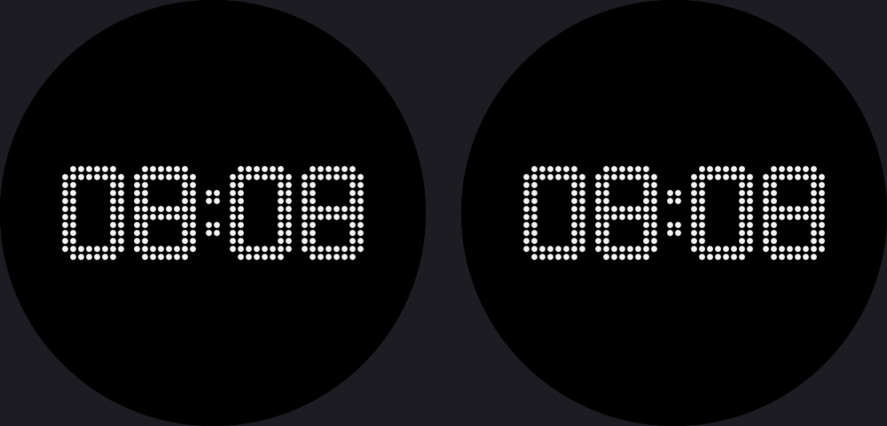
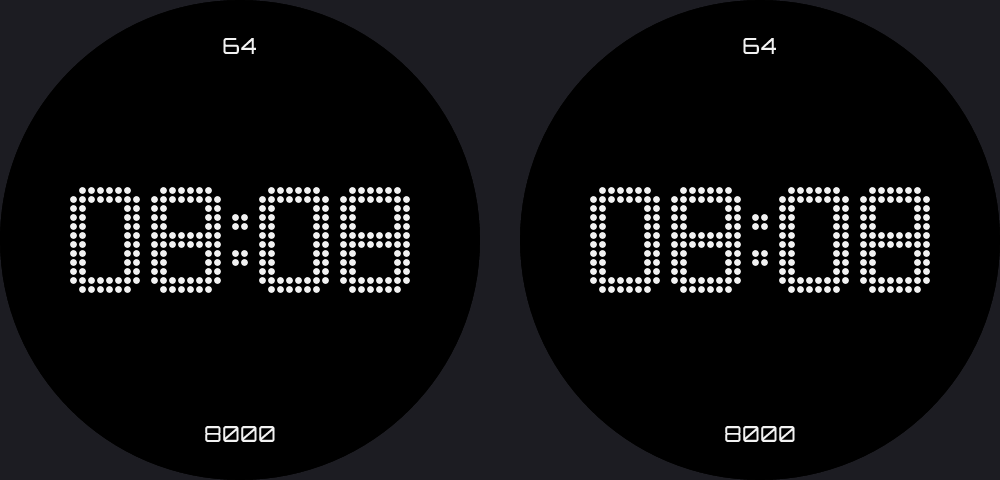

# NOTHING

Точечный цифровой циферблат для Amazfit Active Max (Zepp OS 5.0) в стиле Nothing. Цифры из точек
в рамках 8×12, один цвет, без фона. Обычный экран и AOD одинаковые. Над временем и под ним — по слоту:
шаги, пульс или заряд.





Спецификация: [docs/spec.md](docs/spec.md).
Часы и слоты переиспользуются в [SEGUE](../segue) через `buildNothing` и `nothingAssets`.

```bash
just mock nothing      # офлайн-превью → faces/nothing/mock/preview.png
just preview nothing   # QR-код для установки через Zepp
```
