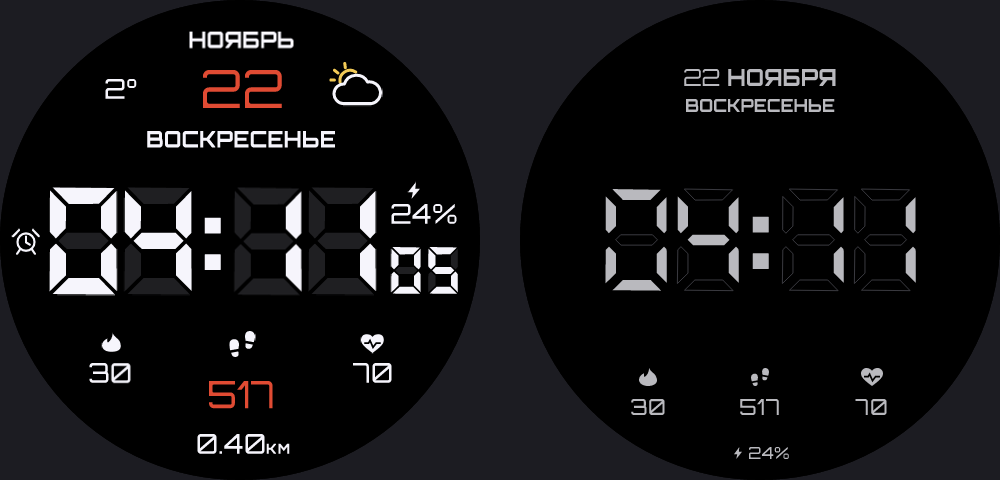
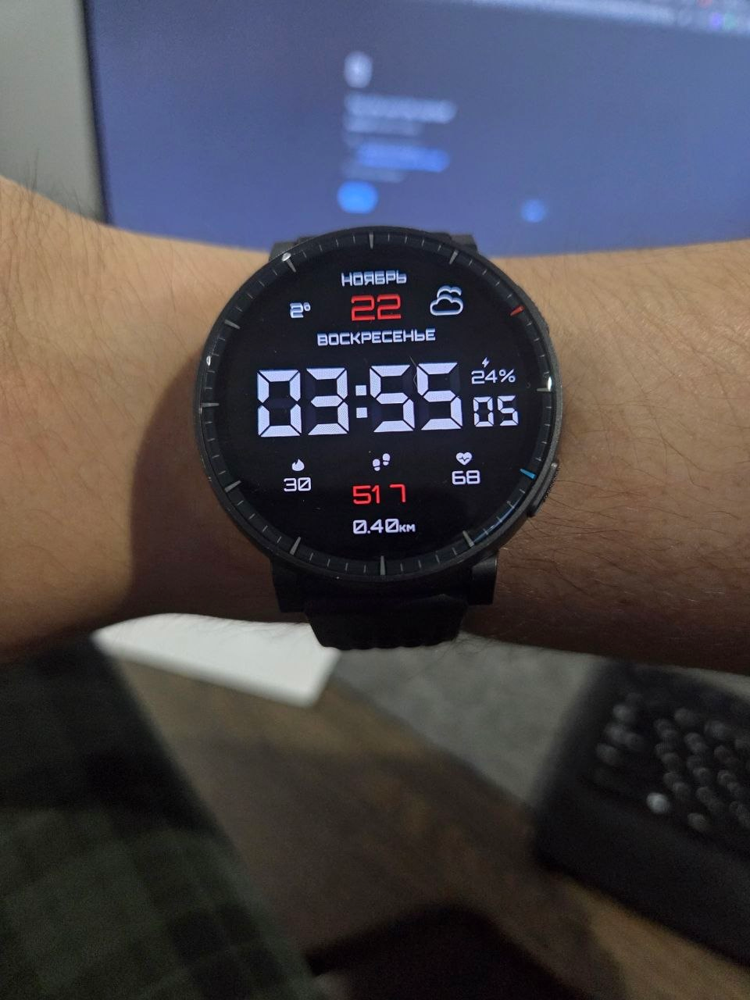
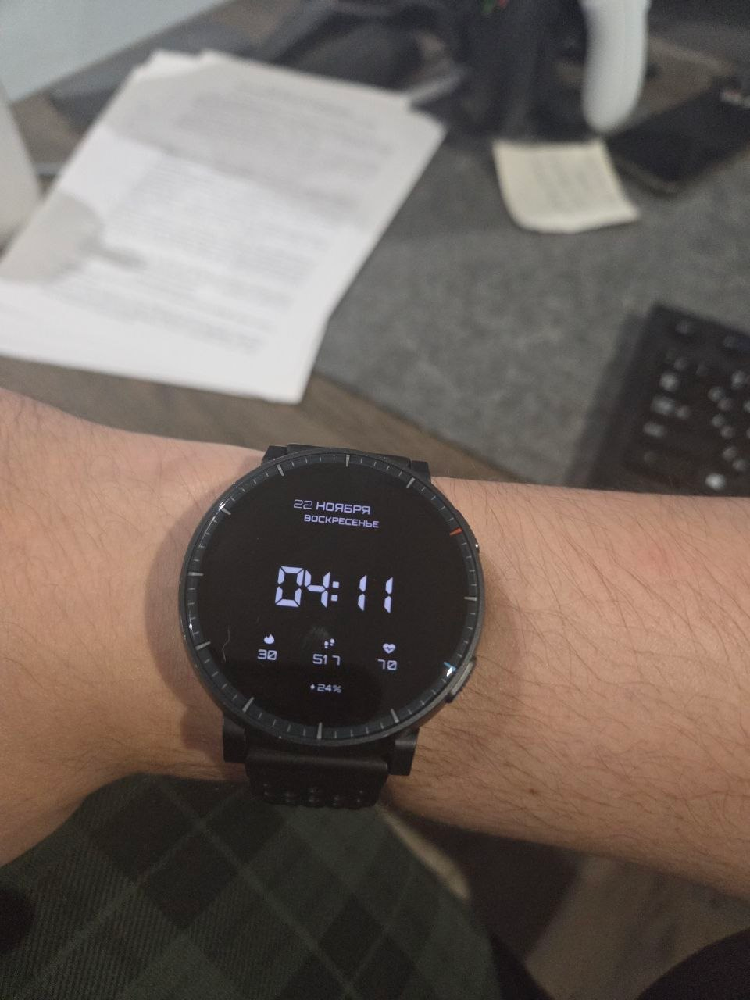

# SEGMENT

**SEGMENT** — реплика циферблата **DM**, который **larrabee777** создал для Amazfit T-Rex 2. Версию SEGMENT для Amazfit Active Max (Zepp OS 5.0) разработал **ExileofAranei**.

## Об оригинале

Спасибо **larrabee777** за оригинальный DM («Everything you need on a black screen»).
Мне так понравились его сегментные цифры и компоновка, что захотелось видеть этот циферблат и на новых часах.
Я восстановил его внешний вид по скриншотам и вручную перерисовал цифры и компоновку.

К сожалению, мне не удалось найти никакой информации об авторе и способа с ним связаться, чтобы спросить
разрешения. Если вы larrabee777 или знаете, как с ним связаться, — напишите, пожалуйста (issue в этом
репозитории). **По первому запросу автора эта копия будет удалена.**

SEGMENT создаётся для личного использования. Любой желающий может установить его на свои часы через QR-код, выполнив `just preview` из корня проекта.

Все права на дизайн DM принадлежат его автору.

## Как выглядит SEGMENT

На макете слева — основной экран с секундами и погодой, справа — режим Always On Display (AOD) с крупным временем и приглушёнными сегментами.



На фотографиях Amazfit Active Max — более ранняя версия. С тех пор в AOD увеличили время и опустили ряд активности ближе к заряду.

| Основной экран на часах | AOD на часах |
| --- | --- |
|  |  |

## Установка на часы

При первой установке пройди шаги от клонирования проекта до включения AOD. [Пошаговая инструкция](../../docs/install.md)

Чтобы установить следующую сборку, выполни из корня проекта:

```bash
just preview segment
```

Выбери **Amazfit Active Max** и отсканируй новый QR-код сканером режима разработчика в Zepp.

Шрифт надписей — Orbitron (SIL OFL 1.1, The League of Moveable Type), кириллица дорисована.
