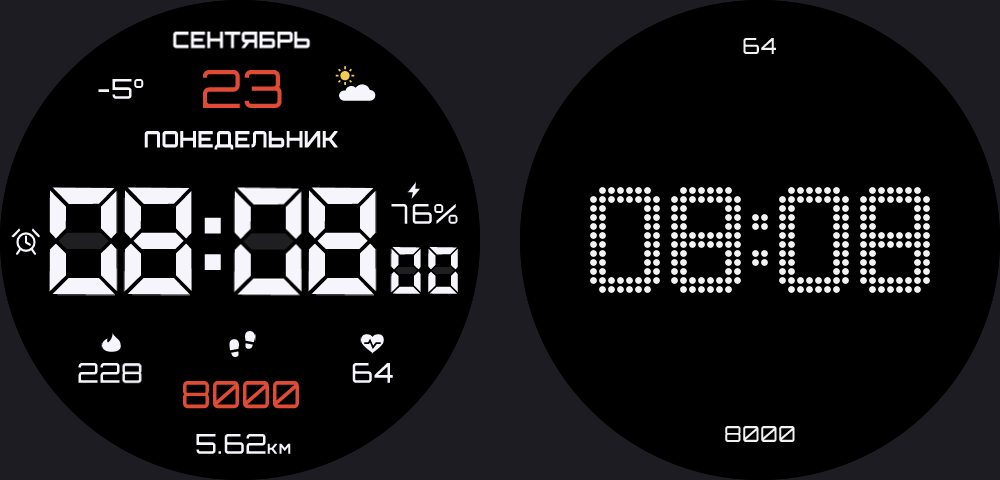

# SEGUE

Комбинация двух циферблатов для Amazfit Active Max: основной экран от [SEGMENT](../segment),
AOD — точечные часы и два слота от [NOTHING](../nothing). Нужен, потому что Zepp OS не даёт выбрать
свой циферблат отдельным стилем AOD.



Своих ассетов и раскладки у SEGUE нет: код и картинки берутся из `faces/segment` и `faces/nothing`,
поэтому правка там сразу попадает и сюда. Пересобери SEGUE после изменений в SEGMENT или NOTHING.

```bash
just mock segue
just preview segue
```
